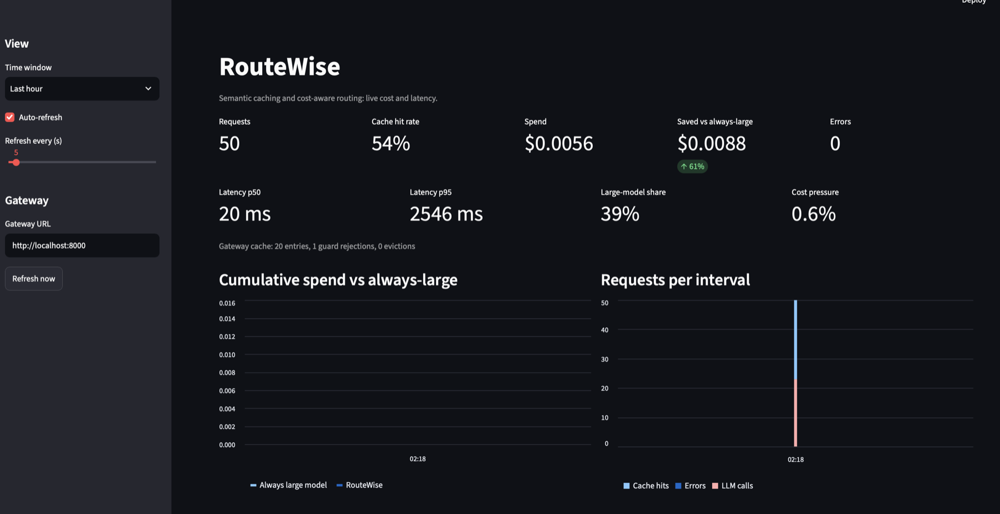
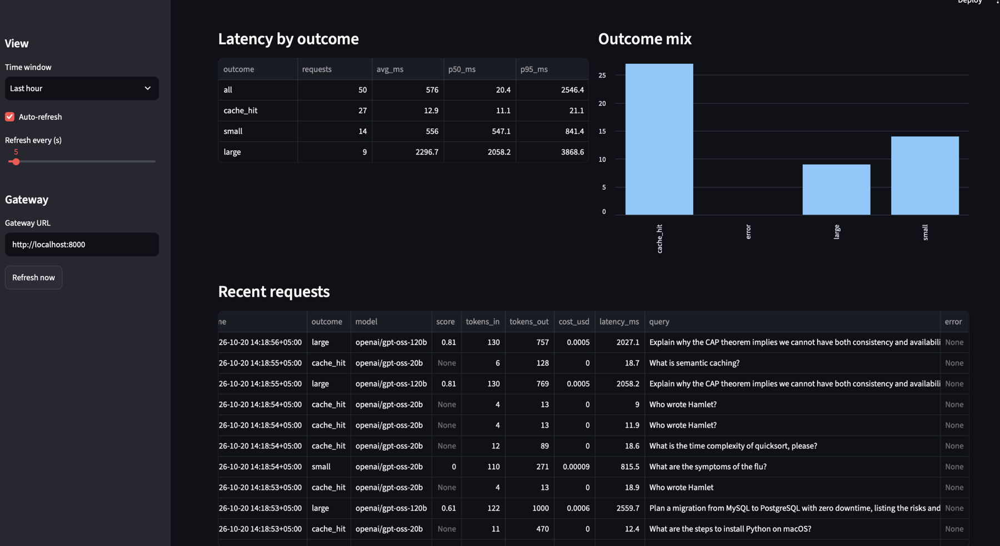
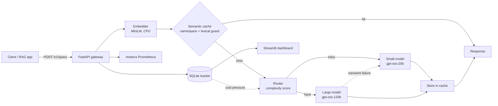

# RouteWise

[](https://github.com/damnalee/routewise/actions/workflows/ci.yml)


**An LLM gateway that sits in front of RAG apps. It answers repeat questions from a semantic cache, sends easy questions to a small model and hard ones to a large model, and tracks cost and latency per request.**





*Dashboard during a demo run on synthetic traffic.*


## Why

A RAG product is affordable at scale only if you stop paying the large model for every question. Many users ask the same thing in different words, and most questions do not need the biggest model. RouteWise is the layer that decides, and measures what that decision saves.

## Architecture



Request flow:

1. Embed the query (one embedding per request).
2. Look up the semantic cache inside the request's namespace. A candidate above the similarity threshold must also pass a lexical guard.
3. On a miss, score query complexity and route to the small or large model.
4. If the large model fails with a transient error, fall back to the small model (marked `degraded`, never cached).
5. Cache the answer, record tokens, cost, and latency, update Prometheus metrics.

## Design decisions

- **Embedding similarity alone is not safe to cache on.** "Celsius to Fahrenheit" and "Fahrenheit to Celsius" scored **0.995** with the same embedding model, so no threshold could separate them. A cheap lexical guard (numbers, negations, word order) vetoes such matches before a cached answer is served.
- **Namespaces scope the cache.** A RAG answer is only valid for the corpus it came from, so hits never cross namespaces (one per knowledge base or tenant).
- **Cost-aware routing.** Recent spend divided by a budget gives a pressure value in [0, 1]. It raises the routing threshold by up to 0.20, pushing borderline queries to the small model. Very hard queries always stay on the large model.
- **Heuristic complexity scorer, behind an interface.** Zero added latency, every score explainable (each signal is returned). A learned classifier can replace it without touching the router.
- **Failure handling.** Multi-key Groq pool with failover on 429, retries with backoff, typed errors mapped to clean HTTP codes, and provider details never leaked to clients.
- **Concurrency bug found by load testing.** Running two requests at once crashed the process: PyTorch on Apple MPS corrupted memory. Mock-based unit tests had missed it. Fix: embeddings default to CPU and every encode call is serialised behind a lock, with a regression test.

## Results

Measured against the live Groq API with the included simulator. **Synthetic workload**: 60 requests, concurrency 2, 25% hard questions, 50% repeat or paraphrase ratio, drawn from a pool of only 10 easy question pairs. The hit rate is inflated by that small pool, so do not read it as production traffic.

| Outcome | Requests | Avg latency |
|---|---|---|
| Cache hit | 41 | 10 ms |
| Small model | 11 | 1,207 ms |
| Large model | 7 | 4,438 ms |
| Small model, degraded fallback | 1 | 10,197 ms |

Spend was **$0.0057 against $0.0164** for answering everything with the large model, about 65% lower. Almost all of that comes from the cache: the price gap between the two Groq models is only about 2x, so routing alone saves little.

### Cache threshold

Labelled paraphrase and different-question pairs (`eval/threshold_pairs.jsonl`), same embedding model, with and without the lexical guard:

| Threshold | Precision (embedding only) | Precision (with guard) | Recall |
|---|---|---|---|
| 0.80 | 0.82 | 0.88 | 0.93 |
| 0.84 | 0.93 | **1.00** | 0.87 |
| 0.86 | 0.92 | 1.00 | 0.73 |
| 0.90 | 0.89 | 1.00 | 0.53 |

Embedding-only precision never reached 0.95 at any threshold. The default is 0.85. The set has only 31 pairs, so treat it as provisional. Full table: `docs/threshold_sweep.md`. Reproduce with `python eval/tune_threshold.py`. Routing evaluation: `python eval/evaluate_router.py`.

## Quickstart

Requires Python 3.11+ and a [Groq](https://console.groq.com) API key.

```bash
git clone https://github.com/damnalee/routewise.git
cd routewise
python3.12 -m venv .venv && source .venv/bin/activate
pip install -e ".[dev]"
cp .env.example .env        # then set ROUTEWISE_GROQ_API_KEYS

python -m uvicorn routewise.app:build_app --factory --port 8000
python -m streamlit run src/routewise/dashboard.py     # second terminal
python scripts/simulate_traffic.py --n 60              # third terminal
```

Run everything from the project root, because the metrics database path is relative.

## API

```bash
curl -s localhost:8000/v1/query -H 'Content-Type: application/json' \
  -d '{"query": "How do I reset my password?", "namespace": "docs"}'
```

| Endpoint | Purpose |
|---|---|
| `POST /v1/query` | Answer a query. Fields: `query`, `context`, `namespace`, `use_cache`, `force_tier`, `temperature`, `max_tokens` |
| `GET /v1/stats` | Totals, savings, latency percentiles, cache stats |
| `POST /v1/cache/clear` | Invalidate one namespace or everything |
| `GET /healthz`, `/readyz` | Liveness and readiness (readiness checks the LLM provider) |
| `GET /metrics` | Prometheus metrics |

The response reports `source` (cache, small, large), cost, saved cost versus the large model, tokens, and latency. Set `ROUTEWISE_GATEWAY_API_KEY` to require a key on `/v1/*`.

## Configuration

Set through environment variables or `.env`, see `.env.example`.

| Variable | Default | Meaning |
|---|---|---|
| `ROUTEWISE_LLM_PROVIDER` | `groq` | `groq` or `ollama` |
| `ROUTEWISE_GROQ_API_KEYS` | empty | Comma-separated keys, rotated with failover |
| `ROUTEWISE_SMALL_MODEL`, `ROUTEWISE_LARGE_MODEL` | `openai/gpt-oss-20b`, `openai/gpt-oss-120b` | Model IDs per tier |
| `ROUTEWISE_CACHE_SIMILARITY_THRESHOLD` | `0.85` | Minimum cosine similarity for a cache hit |
| `ROUTEWISE_ROUTER_THRESHOLD` | `0.30` | Complexity score at or above which the large model is used |
| `ROUTEWISE_BUDGET_USD`, `ROUTEWISE_BUDGET_WINDOW_S` | `1.0`, `3600` | Budget that drives cost pressure |
| `ROUTEWISE_STORE_QUERIES` | `true` | Keep a query preview in the metrics DB |
| `ROUTEWISE_EMBEDDING_DEVICE` | `cpu` | `cpu`, `mps`, or `auto` |

## Project layout

```
src/routewise/
  app.py            HTTP layer: auth, request ids, endpoints
  gateway.py        request pipeline: cache, route, LLM, fallback, accounting
  semantic_cache.py namespaced cache with TTL, LRU, verifier hook
  query_guard.py    lexical guard against false cache hits
  vector_index.py   thread-safe exact cosine index
  embeddings.py     sentence-transformers backend and a test backend
  complexity.py     heuristic query scoring
  router.py         threshold routing with cost pressure
  llm.py, llm_groq.py   Ollama and Groq clients, retries, key pool
  tracker.py        SQLite cost and latency tracking
  metrics.py        Prometheus metrics
  dashboard.py      Streamlit dashboard
eval/               labelled datasets and evaluation scripts
scripts/            traffic simulator
```

## Testing and quality

145 tests, 95% coverage, strict mypy, ruff. GitHub Actions runs lint, format check, type check, and tests with an 80% coverage gate on Python 3.11 and 3.12. Pre-commit hooks run ruff and secret detection. Tests use a deterministic hash embedder and a fake LLM client, so they need no model download or network.

## Limitations

- The lexical guard catches word order, numbers, and negation. It does **not** catch synonym or entity swaps ("refund" vs "cancellation", "iPhone" vs "Android"); only the similarity threshold stops those.
- Cache hits are keyed on query text within a namespace, not on retrieved context. Use separate namespaces, or `use_cache: false`, when the same question must get different answers.
- The routing heuristic and its evaluation set (60 queries) were written by the author. A learned classifier trained on real traffic would be better.
- Reasoning models spend many output tokens (one large-model answer used 2,513). Output tokens dominate cost, so cap `max_tokens`.
- Prices are approximate Groq list prices from config. Check them before trusting dollar figures.
- Identical concurrent cache misses each call the LLM (no single-flight yet).
- SQLite metrics suit a single node. A multi-node deployment would use Prometheus or Postgres.
- The Ollama client is covered only by mocked-transport tests. Groq was tested live.

## Roadmap

Docker image, single-flight for concurrent misses, a cross-encoder verifier for borderline cache scores, a learned routing classifier, streaming responses.

## License

MIT
