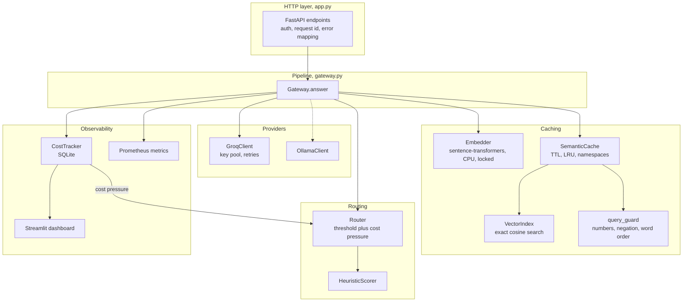
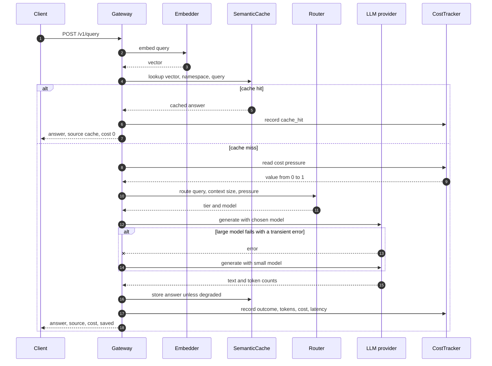
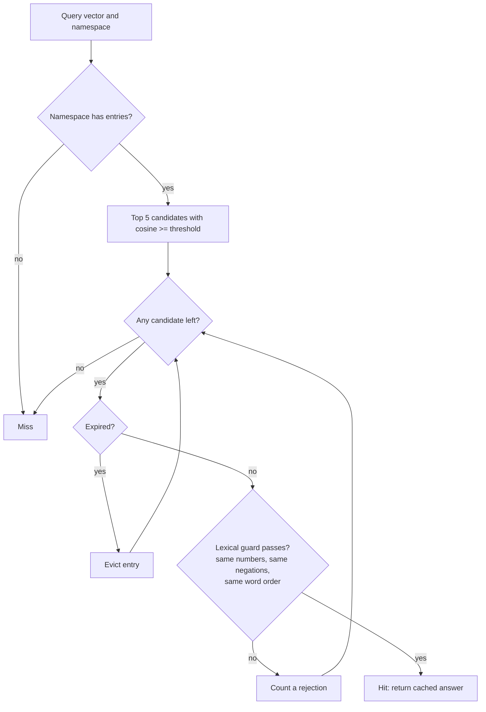
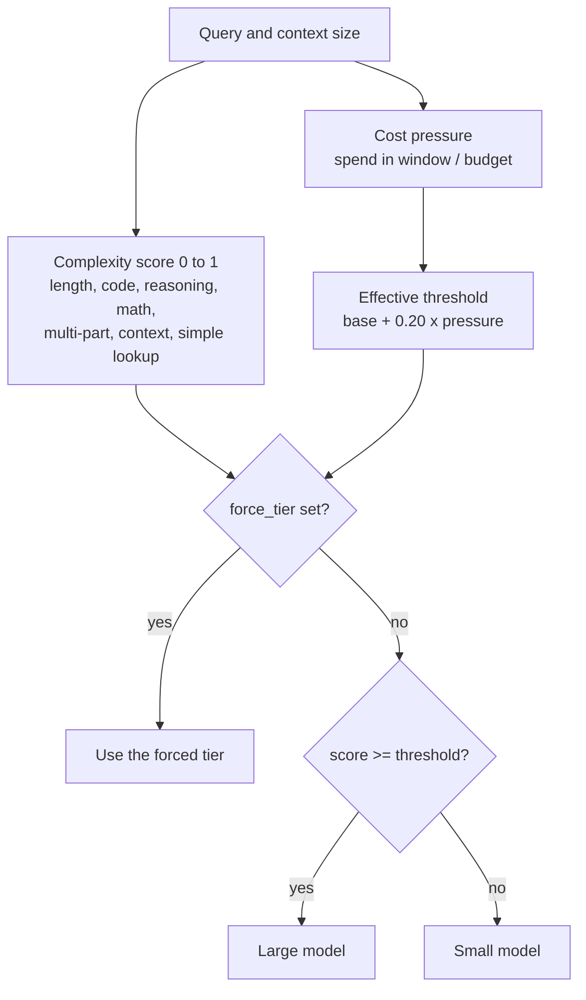
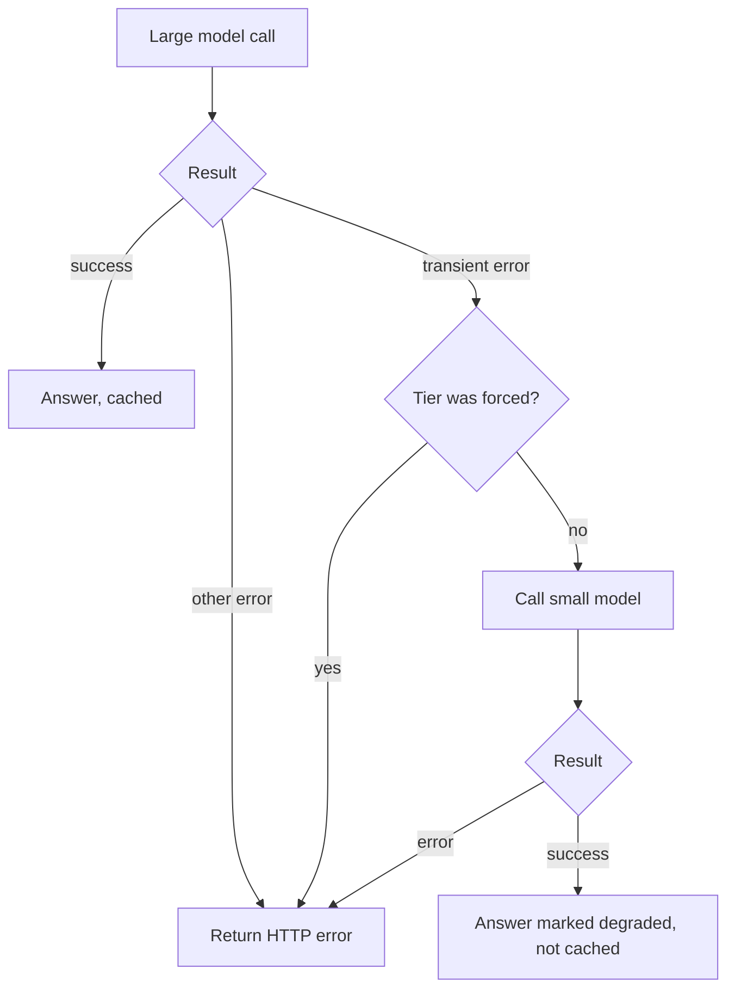
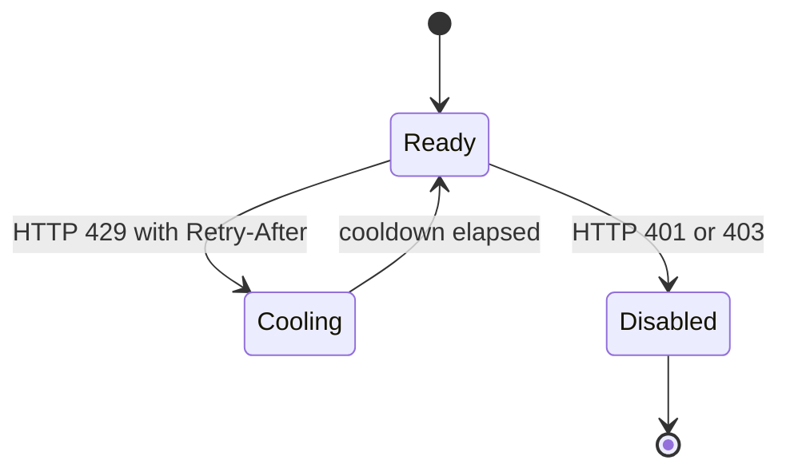
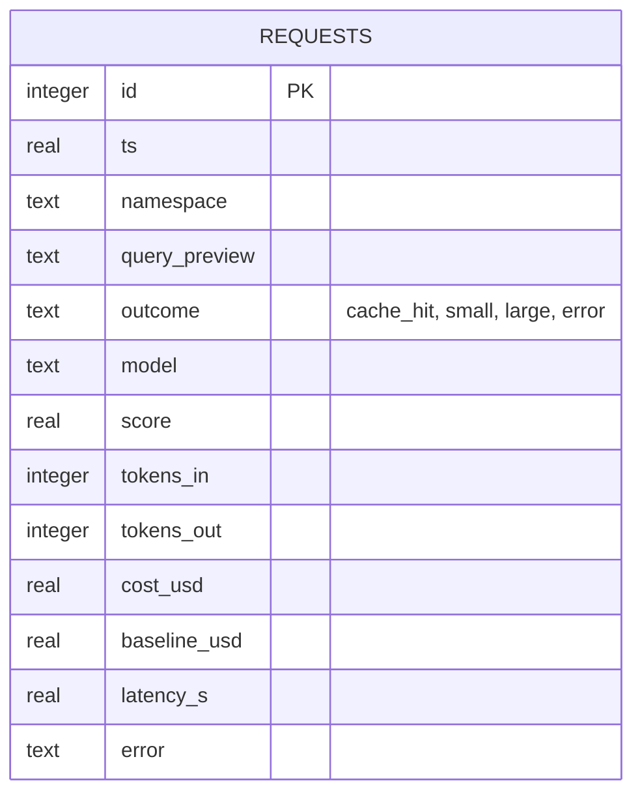

# RouteWise architecture

Diagrams render on GitHub. Source code lives in `src/routewise/`.

## 1. Components

## 2. One request, end to end

## 3. Cache lookup

## 4. Routing decision

## 5. Failure handling

Provider errors map to clean HTTP responses and never leak provider details:

| Provider error | HTTP status | Code |
|---|---|---|
| Rate limited, all keys cooling | 429 with `Retry-After: 5` | `upstream_rate_limited` |
| Timeout | 504 | `upstream_timeout` |
| Unavailable or 5xx | 503 | `upstream_unavailable` |
| Auth, bad response, model not found | 502 | `upstream_error` |

Groq API key life cycle, per key:

## 6. Data model

One SQLite table, written once per request.

## How savings are computed

- `baseline_usd`: what the same request would have cost on the large model.
- `cost_usd`: what it actually cost. Zero for cache hits and errors.
- `saved = baseline - cost`. A cache hit counts the full large-model cost as saved, using estimated tokens (flagged `tokens_estimated`).
- Prices are approximate reference values from config. Verify them at console.groq.com.
